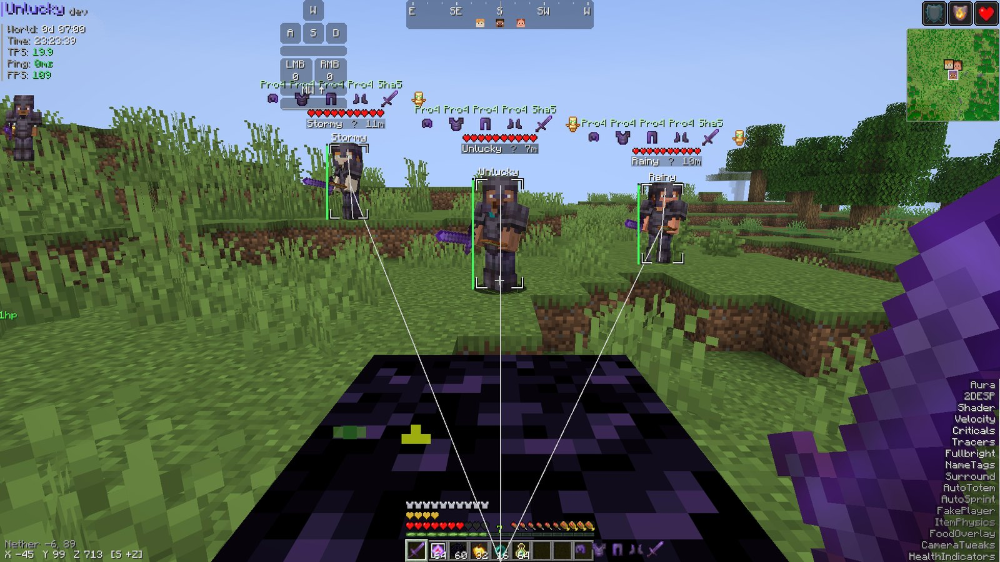
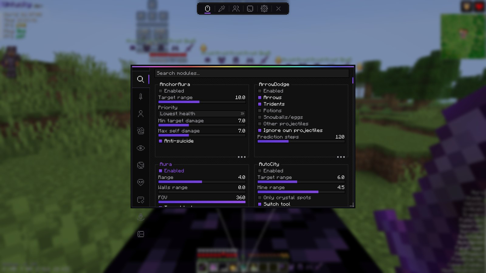
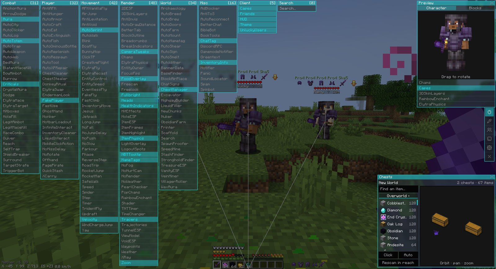
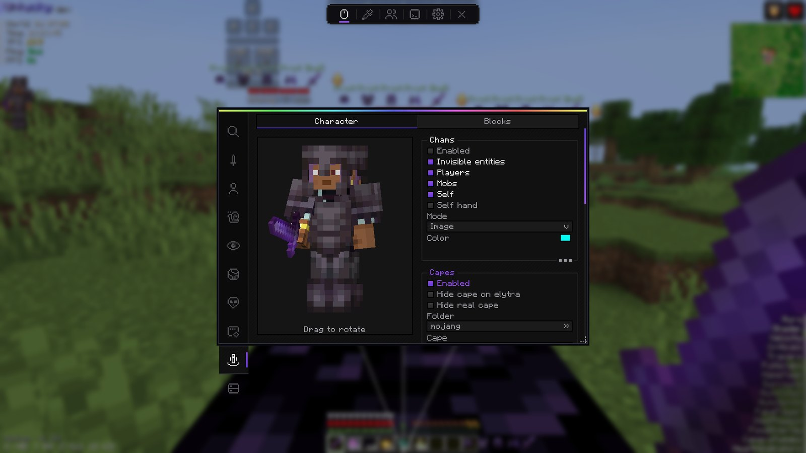
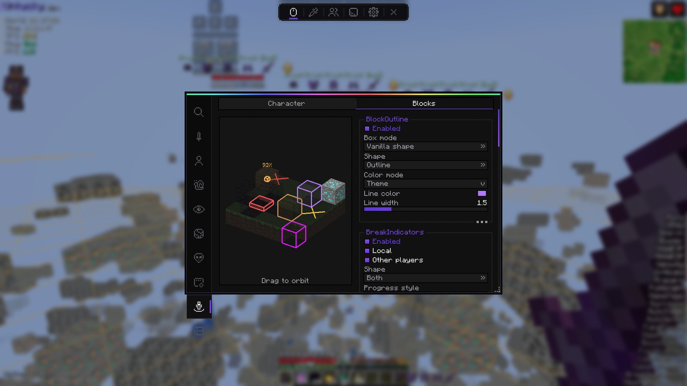
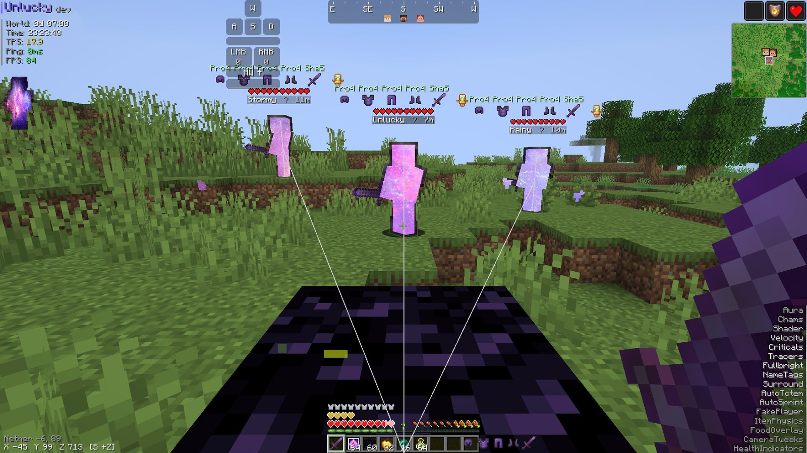
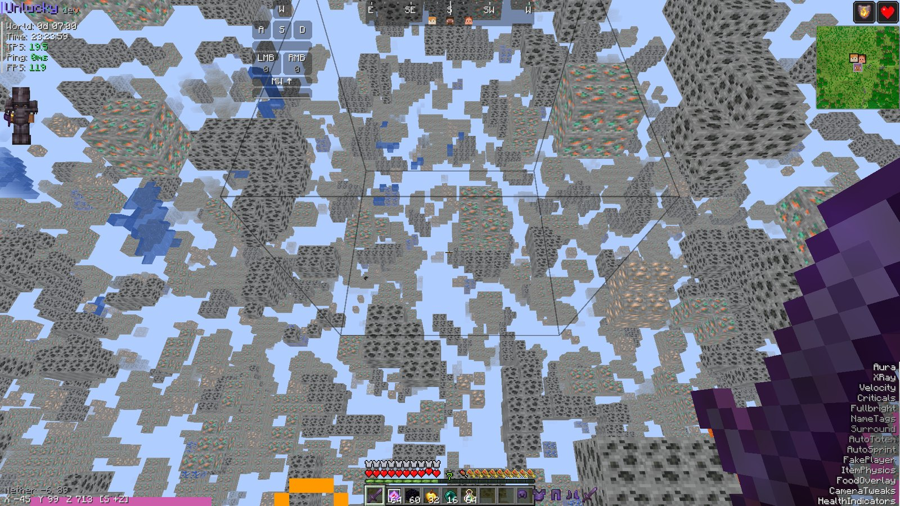
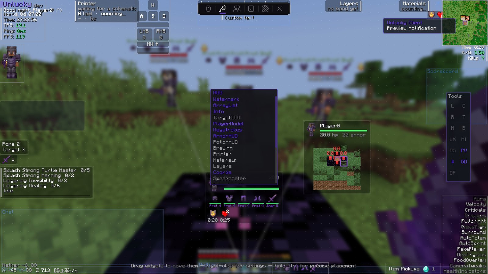

<div align="center">


**A Fabric utility client that cares how it looks.**

Two ClickGUI styles, a HUD you can drag anywhere, a full ESP suite, and 208 modules,<br>
built for singleplayer and anarchy servers.

[](https://github.com/lucieneth/UnluckyUtilityMod/releases/latest)
[](https://www.minecraft.net/)
[](https://fabricmc.net/use/)
[](LICENSE)




</div>

---

## What is this?

Unlucky Client is a utility mod for Minecraft 26.3 on Fabric. Its rule is simple: if something
is on your screen, it should look good. So every widget can be styled, every module has its own
live preview, and the menus are as nice to use as they are to look at.

It's packed, too. There's crystal and anchor PvP, elytra and mace tricks, base hunting,
schematic printing, highway building and a long list of small quality-of-life fixes.

> [!WARNING]
> **This is a cheat client.** It's made for **singleplayer and anarchy servers**. There is
> **no anticheat bypass** and there never will be. Don't take it somewhere it isn't welcome and
> then act surprised.

## Screenshots

<table>
  <tr>
    <td width="50%"></td>
    <td width="50%"></td>
  </tr>
  <tr>
    <td align="center"><b>Skeet ClickGUI</b>: one tidy window with category tabs and search</td>
    <td align="center"><b>Future ClickGUI</b>: every category on screen at once</td>
  </tr>
  <tr>
    <td></td>
    <td></td>
  </tr>
  <tr>
    <td align="center"><b>Live previews</b>: drag to rotate your model while you tweak chams and capes</td>
    <td align="center"><b>Block previews</b>: outlines, break indicators and ESP on a little test scene</td>
  </tr>
  <tr>
    <td></td>
    <td></td>
  </tr>
  <tr>
    <td align="center"><b>Chams</b>: solid, glowing or image-filled silhouettes</td>
    <td align="center"><b>XRay</b>: only the blocks that matter</td>
  </tr>
</table>

<div align="center">
  
  <br><b>HUD editor</b>: drag, snap, duplicate and restyle 24 widgets
</div>

## Highlights

- **Two ClickGUIs, one config.** Skeet keeps everything in one neat window. Future spreads every
  category across the screen. Switch between them under *Theme → ClickGUI style*.
- **A HUD that's actually yours.** Widgets snap to edges, centres and each other. There are
  safe-area guides for chat, the hotbar and boss bars, and you can hold `Ctrl` for pixel-exact
  placement. Every widget has its own colours, scale, anchor and animation, and you can
  duplicate one to get an independent copy.
- **ESP that reads at a glance.** Shader silhouettes, CS-style 2D boxes with health and armor
  bars, chams, tracers, name tags with enchanted gear, and pop chams for when someone burns a totem.
- **Real combat math.** CrystalAura, AnchorAura and BedAura all use a proper damage model.
  AutoTotem looks at the fall you're committed to and the crystals in range, not just your health
  bar. Rotations are silent, so your body turns while your camera stays put.
- **Builders that build.** Print Litematica schematics, pave highways, dig out a box between
  two corners, or catalogue every chest in your base with ChestManager and search it later.
- **Capes for everyone.** Official capes come straight from Mojang. Community capes stream live
  from the [Capes repo](https://github.com/lucieneth/Capes), so new capes show up without an update.

## Features

Click a category to see everything in it. Every module is listed.

<details>
<summary><b>⚔️ Combat</b> (31 modules)</summary>
<br>

| Module | What it does |
| --- | --- |
| AnchorAura | Places, charges and detonates respawn anchors using a damage model |
| ArrowDodge | Sidesteps projectiles that are predicted to hit you |
| Aura | Attacks nearby targets |
| AutoCity | Breaks a target's surround block to open a crystal spot |
| AutoClicker | Clicks so you don't have to |
| AutoLog | Leaves the server before something kills you |
| AutoTotem | Keeps a totem in your offhand when something is about to kill you |
| AutoTrap | Boxes a target in with a chosen trap preset (with a 3D pattern editor) |
| AutoWeapon | Switches to the best weapon for each hit |
| AutoWeb | Puts cobwebs at a target's feet and head |
| BedAura | Places and detonates beds where they explode, using a damage model |
| BlatantMaceKill | Spoofs a lethal mace fall while you stay on the ground |
| BowAimbot | Leads your bow aim without firing for you |
| Burrow | Places a block at your feet during a vanilla-valid jump |
| Criticals | Turns your hits into critical hits |
| CrystalAura | Places and detonates end crystals using a damage model |
| Dodge | Sidesteps out of melee combos |
| ElytraMace | Takes your elytra off for a real mace smash at the end of a dive, then puts it back on |
| ElytraTarget | Steers an elytra glide toward a target without flying into terrain |
| Hitboxes | Widens attack selection without changing world collision |
| HoleFill | Fills the holes an opponent could use |
| LegitAimbot | Gentle, visible camera assistance near a target |
| LegitMaceKill | Amplifies mace damage only while you're genuinely falling |
| MaceCombo | Chains mace smashes by relaunching with wind charges |
| Quiver | Shoots tipped arrows up at yourself |
| Reach | Extends normal block and entity targeting |
| SelfTrap | Covers your own head against crystals and anchors |
| ShieldBreaker | Disables a raised shield with a quick axe hit |
| Surround | Walls the four squares around your feet (with a 3D pattern editor) |
| TargetStrafe | Orbits the closest target while you hold W |
| TriggerBot | Attacks whatever you're aiming at |

</details>

<details>
<summary><b>🧍 Player</b> (32 modules)</summary>
<br>

| Module | What it does |
| --- | --- |
| AntiAFK | Small, reversible activity so you don't get kicked |
| AntiHunger | Reduces hunger drain from jumping and sprinting |
| AutoArmor | Equips the best armour you're carrying |
| AutoCraft | Crafts recipe-book items in an open crafting menu |
| AutoEat | Eats when you get hungry, with a food blacklist |
| AutoExtinguish | Water-buckets fire away, then cleans up after itself |
| AutoFish | Reels in and recasts when a fish bites |
| AutoOminousBottle | Drinks an ominous bottle when Bad Omen runs out |
| AutoReplenish | Refills a hotbar stack before it runs out, keeping the exact item variant |
| AutoRespawn | Respawns after a configurable delay |
| AutoTool | Swaps to the best tool for the block, with Silk Touch for ender chests and an anti-break floor |
| AutoXPRepair | Repairs mending gear with XP bottles |
| ChestCleaner | Throws selected items out of the container you have open |
| ChestStealer | Loots chests, barrels and shulkers reliably with delayed, server-synced clicks |
| DonkeyRitual | Turns filler blocks into a saved creative hotbar, theatrically |
| ElytraSwap | Swaps chestplate and elytra, and replaces worn-out wings |
| EndermanLook | Keeps your server-side look away from an enderman's eyes |
| FakePlayer | Spawns client-only practice targets |
| FastUse | Removes the delay between right-click uses |
| GhostHand | Uses interactable blocks behind an obstruction, at legal reach |
| Honker | Honks at arriving players |
| HotbarLoadout | Restores a saved creative hotbar in survival with full components intact |
| InfiniteInteract | Reaches blocks and entities up to about 12 blocks away |
| InventoryCleaner | Sorts your inventory and throws out only what you allowed |
| LiquidInteract | Lets normal interactions target water and lava |
| MiddleClickAction | Middle-click throws a pearl, rocket, wind charge or XP bottle |
| NoMissDelay | Removes the attack cooldown after a miss |
| NoRotate | Accepts server position corrections without moving your camera |
| Offhand | Picks your non-totem offhand item |
| PagePirate | Reads books around you into chat |
| QuickStash | Adds take-all and store-all buttons to chests, barrels, shulkers, hoppers and more |
| XCarry | Keeps the 2×2 crafting grid usable as four extra slots |

</details>

<details>
<summary><b>🏃 Movement</b> (42 modules)</summary>
<br>

| Module | What it does |
| --- | --- |
| AFKVanillaFly | AFK elytra flight that holds your altitude |
| AirJump | Jumps again mid-air, or holds you at a level |
| AntiLevitation | Ignores levitation |
| AntiVoid | Predicts falls into the void and rescues you |
| AutoSprint | Sprints for you, in any direction |
| AutoWalk | Holds a direction with simple safety stops |
| Blink | Holds back your movement packets, then sends them all at once |
| BoatFly | Fly the boat you're riding with WASD, jump and sprint |
| BunnyHop | CS-style bunny hopping |
| ClickTP | Teleports you to the block you click |
| CreativeFlight | Fly like you're in creative |
| ElytraFly | Boost, or fly flat while gliding |
| ElytraRecast | Restarts a glide that got interrupted |
| EntityControl | Steer ridden mobs without a saddle or steering item |
| EntitySpeed | Controls the speed of whatever you're riding |
| EventlessFly | Direct-packet flight that skips ordinary movement events |
| FakeFly | Elytra flight without an elytra (singleplayer/LAN only) |
| FastClimb | Climbs ladders and vines faster |
| InventoryMove | Move and look around with a screen open |
| Jesus | Walk on water |
| Jetpack | Rocket upward on the jump key |
| LongJump | A boosted jump through normal movement |
| NoFall | Removes fall damage |
| NoJumpDelay | Removes the delay between jumps |
| NoPush | Ignores pushing from entities and blocks |
| NoSlow | Cancels your own movement slowdowns |
| Parkour | Jumps automatically at the edge of a block |
| Phase | Move through blocks |
| ReverseStep | Drops off ledges at a chosen speed |
| RoadTrip | Travel reports and safeties for long AFK trips |
| RocketJump | Rocket-boosted jumps |
| RocketMan | Easy firework elytra flight |
| SafeWalk | Won't let you walk off ledges |
| Speed | Move faster than normal |
| Spider | Climb walls |
| Step | Walk up taller blocks without jumping |
| Timer | Speeds up or slows down the game tick rate |
| TridentFly | Riptide flight without rain, water or the enchant |
| Updraft | Wind charge jump boosts |
| Velocity | Controls knockback and other pushes |
| WindChargeJump | Jumps when you throw a wind charge under yourself |
| Yaw | Locks your facing to a fixed direction |

</details>

<details>
<summary><b>👁️ Render</b> (48 modules)</summary>
<br>

| Module | What it does |
| --- | --- |
| 2DESP | CS-style screen-space boxes with health and armor bars |
| 3DSkinLayers | Voxel second skin layer instead of the flat one |
| AntiInvis | Shows invisible entities as translucent |
| AutoDrawDistance | Holds an FPS target by adjusting render distance |
| BetterTab | A tab list that scales and tells you who is who |
| BlockOutline | Restyles the selected-block outline |
| Breadcrumbs | Draws a trail behind you |
| BreakIndicators | Shows block-break progress for you and other players |
| CameraTweaks | Third-person distance, wall clipping and scroll to zoom |
| Chams | Renders entities as solid, see-through silhouettes |
| ElytraPhysics | Cape-like sway physics for your elytra |
| EntityOwner | Shows who owns that pet or projectile |
| FocusFps | Caps FPS while the window is unfocused |
| FoodOverlay | Full AppleSkin: saturation, exhaustion, restore previews and food tooltips |
| Freecam | Fly the camera around freely |
| Freelook | Look around without turning your body |
| Fullbright | Lights up the whole world |
| Heads | Player heads next to names in chat |
| HealthIndicators | Floating damage and healing numbers |
| HitEffects | Particles, a hitmarker and hitsounds where hits land |
| HoleESP | Marks holes a crystal can't reach into |
| ItemESP | Labels and tracers for dropped items |
| ItemFrames | Culls distant item frames, a big FPS win in storage rooms |
| ItemHighlight | Highlights chosen items in any container |
| ItemPhysics | Dropped items lie flat and tumble as they fall |
| LightOverlay | Marks ground where hostile mobs can spawn |
| LogoutSpots | Marks where players were when they logged out |
| NameTags | Rich name tags with gamemode, health, ping, distance and enchanted armor |
| NBTTooltip | Shows raw item data and copies it from the tooltip |
| NoFog | Removes distance, Nether and End fog |
| NoHurtCam | Removes the camera tilt when you take damage |
| NoRender | Turns off overlays, the totem animation, boss bars and situational fog |
| NoWeather | Clear skies, always |
| PearlChecker | Labels pearls and predicts where they'll land |
| PopChams | Flashes a fading ghost over players who pop a totem |
| RainbowEnchant | Recolours the enchantment glint |
| Shader | Silhouette highlighting through the ESP mask |
| TimeChanger | Changes the rendered time of day |
| TNTTimer | Shows primed TNT fuse time and who lit it |
| Tracers | Draws lines to selected entities |
| Trajectories | Predicts held and fired projectile paths |
| TunnelESP | Highlights dug tunnels |
| ViewModel | Repositions your first-person hands |
| VoidESP | Marks holes in the bedrock that lead to the void |
| Waypoints | Beacon beams for saved places, and a marker where you died |
| Weather | Overrides the client-side weather |
| XRay | See only the blocks that matter, with presets and a block picker |
| Zoom | Hold a key to zoom in smoothly |

</details>

<details>
<summary><b>🌍 World</b> (34 modules)</summary>
<br>

| Module | What it does |
| --- | --- |
| Archaeology | Finds suspicious sand and gravel |
| AutoBreed | Feeds nearby animals that can breed |
| AutoBrew | Brews potions from assigned chests |
| AutoDoors | Opens doors for you, and closes them behind you |
| AutoFarm | Harvests grown crops around you |
| AutoMount | Mounts nearby rideable entities |
| AutoNametag | Uses name tags on chosen entities |
| AutoShear | Shears nearby sheep without breaking your shears |
| AutoSign | Writes placed signs with your last sign's text |
| AutoSmelt | Feeds and empties an open furnace |
| AutoWither | Builds a wither for you |
| BannerData | Right-click a banner to read its data |
| BaseFinder | Flags chunks somebody has built in, and remembers them per server |
| BlockAirPlace | Place blocks against air |
| ChatSigns | Reads nearby signs into chat |
| ChestManager | A searchable record of every chest in your base (`.cm`) |
| Excavator | Digs out the box between two corners (`.excavate`) |
| HighwayBuilder | Digs and paves a straight highway |
| LiquidFiller | Fills liquid sources in reach |
| NewChunks | Highlights chunks that are likely newly generated |
| Nuker | Breaks all matching blocks around you |
| ObsidianFarm | Places and mines ender chests for obsidian |
| Printer | Prints nearby Litematica blocks, with optional job automation |
| Scaffold | Builds a bridge, a tower, or a safe one-block descent under you |
| Search | Find any block and see it through walls |
| SpawnProofer | Covers spawnable ground around you |
| SpeedMine | Finishes the block you're mining sooner |
| StashFinder | Records chunks that are full of storage |
| StrongholdFinder | Estimates the stronghold from your Eye of Ender throws |
| TreasureESP | Finds buried chests |
| VanityESP | Highlights map art and banners |
| VeinMiner | Break one ore, get the whole vein |
| VillagerRoller | Rerolls librarian books automatically (by FlexCoral) |
| WaxAura | Waxes signs in reach |

</details>

<details>
<summary><b>🧰 Misc</b> (16 modules)</summary>
<br>

| Module | What it does |
| --- | --- |
| AdBlocker | Blocks chat advertisers |
| AntiToS | Censors blacklisted words when they're drawn |
| AutoReconnect | Puts you back on the server you fell off, and knows a kick from you leaving |
| BetterChat | Timestamps, collapsed duplicate lines and regex filtering |
| BibleBot | Sends a random Bible verse on a timer |
| BookTools | Book editing and reading helpers |
| ChatTag | Highlights your name in chat, with an optional ping |
| DiscordRPC | Shows Unlucky Client on your Discord profile |
| GamemodeNotifier | Tells you when players switch gamemode |
| Greentext | Prefixes your chat with `>` so the server shows it green |
| InventoryInfo | Richer tooltips: shulker, ender chest, map, banner and book previews |
| Notifier | Alerts for visual range, totem pops and low armor |
| Panic | One key that turns off everything the server can see |
| SoundLocator | Logs nearby sounds with coordinates |
| Spam | Sends a chat message on a timer |
| Spinbot | Visual-only spin, CS:GO style |

</details>

<details>
<summary><b>🎨 Client</b> (5 modules)</summary>
<br>

| Module | What it does |
| --- | --- |
| Capes | Wear a custom cape, or hide your own |
| Friends | Middle-click players to friend them, with dots in the tab list, name tags and chat |
| HUD | Draws the client HUD and holds the shared panel style |
| Theme | Accent colours, menu blur and the ClickGUI style |
| UnluckyUsers | See other Unlucky users and their capes |

</details>

<details>
<summary><b>🖥️ HUD widgets</b> (24 widgets)</summary>
<br>

| Widget | What it shows |
| --- | --- |
| ArmorHUD | Your armor and its durability |
| ArrayList | Your enabled modules, with an animated gradient |
| Brewing | AutoBrew's progress |
| CompassBar | A compass strip with player heads on it |
| Coords | Your position, plus the other dimension's coordinates |
| CrystalMap | Your target plus a little 3D map of every crystal spot around them, coloured by damage |
| CustomText | Whatever you want it to say |
| Greeter | A friendly hello |
| Info | FPS, ping, TPS and time rows |
| InventoryViewer | Your inventory, always visible |
| ItemCounter | How many of an item you're carrying |
| ItemPickups | What you just picked up |
| Keystrokes | WASD, mouse buttons and CPS |
| Layers | Printer layer progress |
| Materials | What the Printer still needs |
| PlayerModel | Your character, live |
| PopCounter | Totem pops per player |
| PotionHUD | Active effects and their timers |
| Printer | Printer status |
| Radar | A minimap with nearby players |
| SessionInfo | Kills, deaths and K/D |
| Speedometer | Your speed, with a sparkline |
| TargetHUD | Your target's model, health, gear and potions |
| Watermark | The Unlucky logo |

</details>

<details>
<summary><b>💬 Chat commands</b></summary>
<br>

Type these in chat with a `.` prefix, with tab completion as you type. `.help` lists everything.

| Command | What it does |
| --- | --- |
| `.toggle <module>` / `.t` | Toggle a module |
| `.bind <module> <key>` | Bind a module to a key |
| `.friend add\|remove <name>` | Manage friends |
| `.waypoint` / `.wp` | Add, remove and list waypoints |
| `.vclip up\|down <blocks>` | Short vertical clip |
| `.hclip <blocks>` | Short horizontal clip |
| `.drop hand\|hotbar\|all` | Drop items in bulk |
| `.peek` | Peek inside the shulker you're holding |
| `.server` | Address, brand, version and the plugins the server exposes |
| `.fov [value]` | Read or set your FOV from chat |
| `.macro add <key> <line>` | Bind a chat line to a key |
| `.give <item> [count]` / `.enchant <enchantment> [level]` | Creative helpers |
| `.excavate` | Drive the Excavator |
| `.cm` | Search and manage ChestManager records |
| `.stashes` | Browse what StashFinder recorded |
| `.panic` | Same as the Panic key |

There's also a CS:GO-style console on `;`.

</details>

## Install

1. Install [Fabric Loader](https://fabricmc.net/use/) for Minecraft **26.3**.
2. Download the latest jar from [Releases](https://github.com/lucieneth/UnluckyUtilityMod/releases/latest).
3. Put it in your `mods` folder along with [Fabric API](https://modrinth.com/mod/fabric-api).
4. Launch the game. The window title says `Unlucky Client` once it has loaded.

You'll need Java 25. Still on 26.2? Use [v2.3.1](https://github.com/lucieneth/UnluckyUtilityMod/releases/tag/v2.3.1),
which lives on the `26.2` branch.

## Controls

| Key | Action |
| --- | --- |
| `Right Shift` | Open the ClickGUI |
| `Right Ctrl` | Open the HUD editor |
| `C` (hold) | Smooth zoom |
| `;` | Open the console |

Any module can be bound to a key from its **Bind** row in the ClickGUI. The icon bar at the
top switches between the ClickGUI, HUD editor, Friends and Configs, and it works from the title
screen too. Everything saves to `config/unlucky/` automatically.

There's also an in-game **skin and cape changer** on the title screen. It makes real account
changes through Mojang's API, not spoofed ones.

## Capes

Capes are streamed rather than bundled. Official capes come from Mojang's own servers, and
community capes come live from the [Capes repo](https://github.com/lucieneth/Capes). Add a PNG
there and it shows up in everyone's picker on their next launch, with no client update needed.
Everything is cached in `config/unlucky/capes/` for offline use.

## Building from source

```
run.bat             # double-click dev launcher (Windows)
gradlew runClient   # launch a dev client
gradlew build       # build the jar into build/libs/
build.bat           # Windows: build + copy the jar to the repo root
gradlew genSources  # decompiled MC sources for API reference
```

You'll need JDK 25. Local builds are always versioned `dev` (`unlucky-dev.jar`). Real version
numbers only exist on releases, which CI cuts automatically when a `v*` tag is pushed.

The layout follows Meteor: `module/`, `settings/`, `gui/clickgui/`, `gui/hud/`, `util/` and `mixin/`.

## Credits

- **[Lucien](https://github.com/lucieneth)** – author and maintainer.
- **[Claude](https://claude.com/claude-code)** – pair programmer on much of the codebase.
- **[ChatGPT](https://chatgpt.com/)** – lesser programmer, wrote some of the modules.
- **[Meteor Client](https://github.com/MeteorDevelopment/meteor-client)** – the project layout and plenty of module ideas.
- **Future** and **Skeet** – inspiration for the two alternative ClickGUI styles.
- **[FabricMC](https://fabricmc.net/)** – the loader and toolchain everything runs on.

<a href="https://github.com/lucieneth/UnluckyUtilityMod/graphs/contributors">
  
</a>

## Feedback

- Found a bug or want a feature? [Open an issue](https://github.com/lucieneth/UnluckyUtilityMod/issues).

<div align="center">
<br>
<sub>Released under <a href="LICENSE">CC0-1.0</a>. Do whatever you like with it.</sub>
</div>
